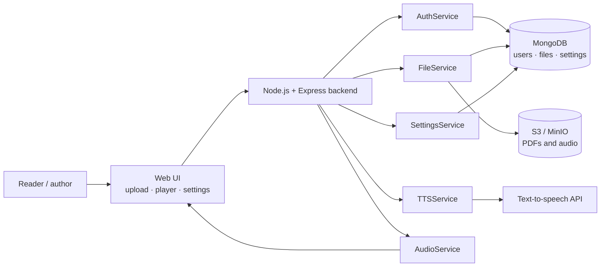

# Voice of Power: Software Architecture

**The design behind [Voice of Power](https://github.com/StynerStiner/Voice_of_Power).** You upload a PDF book and hear it read aloud in the language, voice and speed you pick. I built it so formerly incarcerated people can have their stories heard.

This repo is the design work: the system architecture plus four UML diagrams. I made them before writing the app. The full write-up, with the PlantUML source, is in **[SOFTWARE_ARCHITECTURE.md](SOFTWARE_ARCHITECTURE.md)**.

## Architecture at a glance

| Layer | Responsibility | Technology |
|---|---|---|
| UI | Registration, login, file upload, audio player, settings | HTML, CSS, JavaScript |
| Backend | Auth, file handling, text-to-speech conversion, playback, preferences | Node.js, Express |
| Database | Users, files and their status, language/voice/speed settings | MongoDB (Mongoose) |
| File storage | Uploaded PDFs and generated audio | AWS S3 / MinIO |
| Third party | Turning the text into speech | A text-to-speech API |

## UML diagrams

| Use case | Class |
|---|---|
|  |  |
| **Sequence: user registration** | **Activity: file upload** |
|  |  |

## What this shows

- Breaking a product idea down into services with clear jobs (auth, files, TTS, audio, settings)
- Modeling the data and relationships before building
- Mapping the key user flows (registration and upload) as sequence and activity diagrams, including how invalid files are handled

---

Part of my [portfolio](https://github.com/StynerStiner/StynerDev-Portfolio) · Building & Automation · by [Styner Stiner](https://github.com/StynerStiner)
